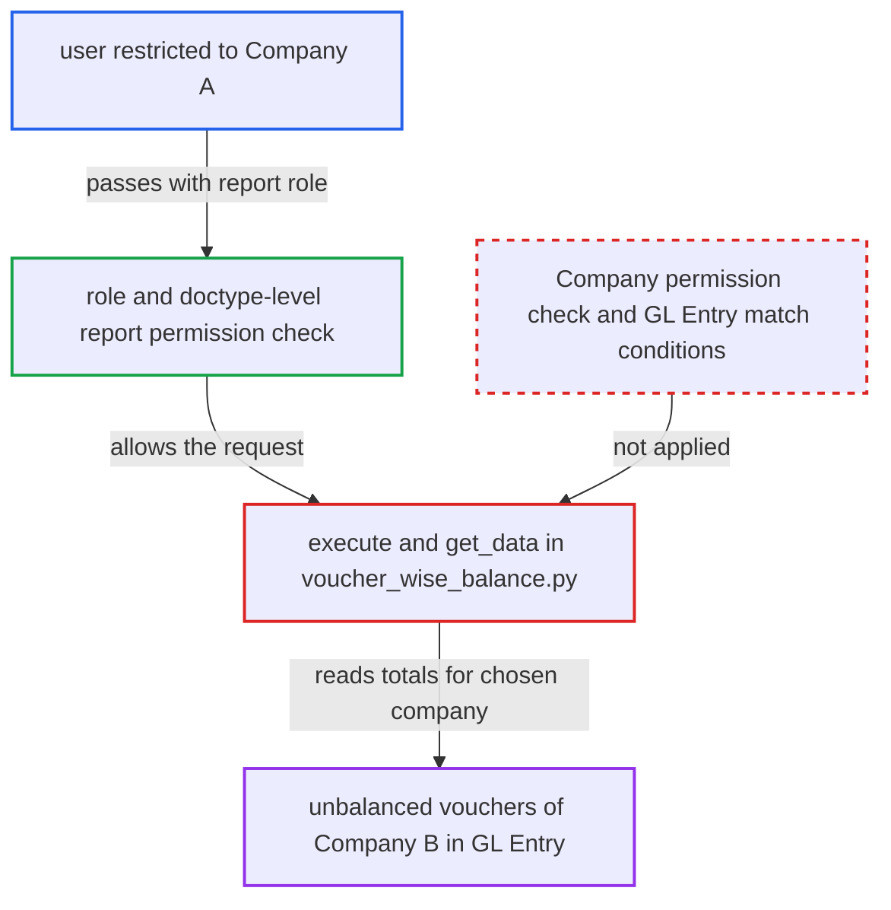

# Voucher-wise Balance report ignores Company and GL Entry user permissions

| Field | Value |
|---|---|
| ID | `find_018Cx9Jvzc7xVzgVABRbNZKd` |
| Severity | **Low** |
| Status | open |
| CWE | CWE-862 — Missing Authorization |
| Created | 2026-10-27T21:11:08.685829Z |
| Claude Security | https://claude.ai/security/findings/find_018Cx9Jvzc7xVzgVABRbNZKd |

## Description

A logged-in user with a restricted company scope can read the unbalanced vouchers of other companies. They see each voucher's type, number and debit and credit totals. They need the Accounts User, Accounts Manager or Auditor role. The report code in `voucher_wise_balance.py` trusts the request's `filters.company` and never checks Company or GL Entry User Permissions.

1. **attacker** sends a report request for another company. The attacker holds an Accounts User, Accounts Manager or Auditor role but is restricted by User Permissions to Company A. They POST to `/api/method/frappe.desk.query_report.run` with `report_name=Voucher-wise Balance` and `company` set to Company B. ([`erpnext/accounts/report/voucher_wise_balance/voucher_wise_balance.json`](https://github.com/cx-benchmark/erpnext/blob/90e7aefca73da3c440d2e8da7472fcb67838e678/erpnext/accounts/report/voucher_wise_balance/voucher_wise_balance.json))
2. **report runner** lets the request through on role checks alone. The report has an empty `filters` table, so the runner checks only the role and the doctype-level `report` permission on GL Entry. Both pass, and the `company` value is never checked. ([`erpnext/accounts/report/voucher_wise_balance/voucher_wise_balance.json`](https://github.com/cx-benchmark/erpnext/blob/90e7aefca73da3c440d2e8da7472fcb67838e678/erpnext/accounts/report/voucher_wise_balance/voucher_wise_balance.json))
3. **`execute`** accepts the company value and calls `get_data`. It checks only that `company` is present and does not ask whether the caller may access that company. ([`erpnext/accounts/report/voucher_wise_balance/voucher_wise_balance.py:9-15`](https://github.com/cx-benchmark/erpnext/blob/90e7aefca73da3c440d2e8da7472fcb67838e678/erpnext/accounts/report/voucher_wise_balance/voucher_wise_balance.py#L9-L15))
4. **`get_data` with `apply_filters`** sums debit and credit per voucher over `tabGL Entry` for Company B. The query is scoped only by `gle.company == filters.company` plus optional voucher type and date filters. It adds no `build_match_conditions`, no Company permission check and no `get_allowed_companies_condition`. ([`erpnext/accounts/report/voucher_wise_balance/voucher_wise_balance.py:51-79`](https://github.com/cx-benchmark/erpnext/blob/90e7aefca73da3c440d2e8da7472fcb67838e678/erpnext/accounts/report/voucher_wise_balance/voucher_wise_balance.py#L51-L79))
5. **`get_data`** returns every voucher whose debit total differs from its credit total. The rows hold `voucher_type`, `voucher_no` and both totals. They are returned to the restricted user. ([`erpnext/accounts/report/voucher_wise_balance/voucher_wise_balance.py:51-79`](https://github.com/cx-benchmark/erpnext/blob/90e7aefca73da3c440d2e8da7472fcb67838e678/erpnext/accounts/report/voucher_wise_balance/voucher_wise_balance.py#L51-L79))

## Assessment

The attacker is an authenticated desk user with the Accounts User, Accounts Manager or Auditor role. User Permissions limit them to Company A, or to certain Cost Centers, Projects or Accounts, on a site with more than one company. They request the report with another company in `filters.company` and any date range. Rows appear only if that company has vouchers whose GL entries do not balance. The attacker does not control whether such vouchers exist.

Impact: The attacker learns the document numbers, types and debit and credit totals of unbalanced vouchers in companies or dimensions they may not access. This is read-only. Normal posting in `general_ledger.py` rounds entries and either books a round-off entry or throws, so only vouchers from data anomalies appear (bugs, repost problems, direct edits). No other GL rows, accounts or parties are returned.

## Recommendation

`execute` and `apply_filters` in `voucher_wise_balance.py` trust the caller-supplied `company` and run an unrestricted `frappe.qb` aggregation over GL Entry. Company and dimension User Permissions on GL Entry are never enforced for this report.

Fix criteria: The report aggregates only GL Entry rows the session user may read. A `company` the user may not select raises a PermissionError or returns no rows. The user's GL Entry match conditions constrain the query. To verify, run the report as a user restricted to Company A with `company` set to Company B, where Company B holds an unbalanced voucher. No Company B voucher is returned.

## Evidence

**https://github.com/cx-benchmark/erpnext**

- [`erpnext/accounts/report/voucher_wise_balance/voucher_wise_balance.py:51-79`](https://github.com/cx-benchmark/erpnext/blob/90e7aefca73da3c440d2e8da7472fcb67838e678/erpnext/accounts/report/voucher_wise_balance/voucher_wise_balance.py#L51-L79)
- [`erpnext/accounts/report/voucher_wise_balance/voucher_wise_balance.py:9-15`](https://github.com/cx-benchmark/erpnext/blob/90e7aefca73da3c440d2e8da7472fcb67838e678/erpnext/accounts/report/voucher_wise_balance/voucher_wise_balance.py#L9-L15)
- [`erpnext/accounts/report/voucher_wise_balance/voucher_wise_balance.json`](https://github.com/cx-benchmark/erpnext/blob/90e7aefca73da3c440d2e8da7472fcb67838e678/erpnext/accounts/report/voucher_wise_balance/voucher_wise_balance.json)
- [`erpnext/accounts/report/trial_balance/trial_balance.py:40-50`](https://github.com/cx-benchmark/erpnext/blob/90e7aefca73da3c440d2e8da7472fcb67838e678/erpnext/accounts/report/trial_balance/trial_balance.py#L40-L50)
- [`erpnext/accounts/doctype/gl_entry/gl_entry.json:244-251`](https://github.com/cx-benchmark/erpnext/blob/90e7aefca73da3c440d2e8da7472fcb67838e678/erpnext/accounts/doctype/gl_entry/gl_entry.json#L244-L251)
- [`erpnext/accounts/general_ledger.py:398-447`](https://github.com/cx-benchmark/erpnext/blob/90e7aefca73da3c440d2e8da7472fcb67838e678/erpnext/accounts/general_ledger.py#L398-L447)

