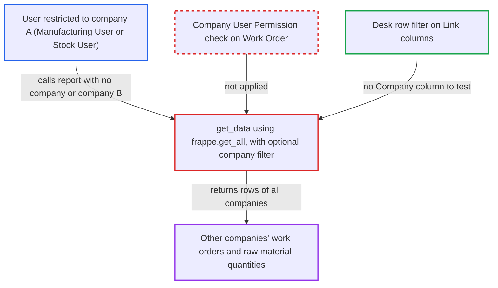

# Work Order Consumed Materials report ignores Company user permissions

| Field | Value |
|---|---|
| ID | `find_01LagynAWnShPh4yWTQZxugc` |
| Severity | **Low** |
| Status | open |
| CWE | CWE-862 — Missing Authorization |
| Created | 2026-10-27T21:20:49.865784Z |
| Claude Security | https://claude.ai/security/findings/find_01LagynAWnShPh4yWTQZxugc |

## Description

A logged-in user with the Manufacturing User or Stock User role, who is limited to one company by a Company User Permission, can read other companies' submitted work orders and their raw material quantities. The attacker only needs to call the report API directly and leave out `company` or name another company. The cause is that `get_data` reads with `frappe.get_all`, which skips User Permissions, and the `company` filter is optional. The data is read-only and has no valuation amounts.

1. **attacker** calls the report API with a chosen company filter. The attacker is a Manufacturing User or Stock User restricted to company A. They call `/api/method/frappe.desk.query_report.run` for `Work Order Consumed Materials` and either omit `company` or set it to company B. ([`erpnext/manufacturing/doctype/work_order/work_order.json:772-795`](https://github.com/cx-benchmark/erpnext/blob/90e7aefca73da3c440d2e8da7472fcb67838e678/erpnext/manufacturing/doctype/work_order/work_order.json#L772-L795))
2. **report definition** accepts the request without checking the filters. The `.js` filter is `reqd` only in the browser, and the Report doc declares `filters: []`, so Frappe does no server-side filter permission check. ([`erpnext/manufacturing/report/work_order_consumed_materials/work_order_consumed_materials.json:10-29`](https://github.com/cx-benchmark/erpnext/blob/90e7aefca73da3c440d2e8da7472fcb67838e678/erpnext/manufacturing/report/work_order_consumed_materials/work_order_consumed_materials.json#L10-L29))
3. **`get_filter_condition`** adds `company` only if the caller sent a value. With no `company` there is no company scoping. A foreign company, or a foreign `name`, is accepted as it is and is not compared with the caller's allowed companies. ([`erpnext/manufacturing/report/work_order_consumed_materials/work_order_consumed_materials.py:68-81`](https://github.com/cx-benchmark/erpnext/blob/90e7aefca73da3c440d2e8da7472fcb67838e678/erpnext/manufacturing/report/work_order_consumed_materials/work_order_consumed_materials.py#L68-L81))
4. **`get_data`** reads Work Orders and Work Order Items with `frappe.get_all`. `frappe.get_all` applies no role or User Permission conditions, so rows from every matching company come back. ([`erpnext/manufacturing/report/work_order_consumed_materials/work_order_consumed_materials.py:17-23`](https://github.com/cx-benchmark/erpnext/blob/90e7aefca73da3c440d2e8da7472fcb67838e678/erpnext/manufacturing/report/work_order_consumed_materials/work_order_consumed_materials.py#L17-L23))
5. **desk row filter** fails to remove the other company's rows. The output has only `Work Order` and `Item` Link columns and no Company column, so the user-permission row filter has no Company value to test. ([`erpnext/manufacturing/report/work_order_consumed_materials/work_order_consumed_materials.py:84-131`](https://github.com/cx-benchmark/erpnext/blob/90e7aefca73da3c440d2e8da7472fcb67838e678/erpnext/manufacturing/report/work_order_consumed_materials/work_order_consumed_materials.py#L84-L131))

## Assessment

The attacker is a logged-in desk user with the Manufacturing User or Stock User role. Both roles have read and report access on Work Order, so the role check passes. The site must have several companies, and the attacker's Company User Permission must limit them to one. They call `frappe.desk.query_report.run` directly with `report_name` set to `Work Order Consumed Materials` and `filters` holding only dates. Alternatively they set `company` to another company, or `name` to another company's work order. The report does not need `company` on the server.

Impact: The attacker can read other companies' submitted work orders. This covers IDs, status, production items, planned and produced quantities, and the required, transferred, consumed, extra-consumed and returned quantities per raw material. The disclosure is read-only. No valuation amounts are returned, and nothing can be written or made unavailable.

## Recommendation

The report reads Work Orders with `frappe.get_all`, which ignores permissions, and limits them only by an optional `company` filter the caller controls. This bypasses the caller's Company User Permissions on Work Order.

Fix criteria: Every returned row belongs to a work order the caller may read under their User Permissions. This holds when `company` is omitted, allowed or disallowed, and when `name` names a foreign work order. A Manufacturing User or Stock User restricted to company A gets no company B rows from `frappe.desk.query_report.run` in each of these cases.

## Evidence

**https://github.com/cx-benchmark/erpnext**

- [`erpnext/manufacturing/report/work_order_consumed_materials/work_order_consumed_materials.py:17-23`](https://github.com/cx-benchmark/erpnext/blob/90e7aefca73da3c440d2e8da7472fcb67838e678/erpnext/manufacturing/report/work_order_consumed_materials/work_order_consumed_materials.py#L17-L23)
- [`erpnext/manufacturing/report/work_order_consumed_materials/work_order_consumed_materials.py:68-81`](https://github.com/cx-benchmark/erpnext/blob/90e7aefca73da3c440d2e8da7472fcb67838e678/erpnext/manufacturing/report/work_order_consumed_materials/work_order_consumed_materials.py#L68-L81)
- [`erpnext/manufacturing/report/work_order_consumed_materials/work_order_consumed_materials.py:84-131`](https://github.com/cx-benchmark/erpnext/blob/90e7aefca73da3c440d2e8da7472fcb67838e678/erpnext/manufacturing/report/work_order_consumed_materials/work_order_consumed_materials.py#L84-L131)
- [`erpnext/manufacturing/report/work_order_consumed_materials/work_order_consumed_materials.json:10-29`](https://github.com/cx-benchmark/erpnext/blob/90e7aefca73da3c440d2e8da7472fcb67838e678/erpnext/manufacturing/report/work_order_consumed_materials/work_order_consumed_materials.json#L10-L29)
- [`erpnext/manufacturing/report/work_order_consumed_materials/work_order_consumed_materials.js:6-13`](https://github.com/cx-benchmark/erpnext/blob/90e7aefca73da3c440d2e8da7472fcb67838e678/erpnext/manufacturing/report/work_order_consumed_materials/work_order_consumed_materials.js#L6-L13)
- [`erpnext/manufacturing/doctype/work_order/work_order.json:772-795`](https://github.com/cx-benchmark/erpnext/blob/90e7aefca73da3c440d2e8da7472fcb67838e678/erpnext/manufacturing/doctype/work_order/work_order.json#L772-L795)
- [`erpnext/manufacturing/report/work_order_summary/work_order_summary.py:68-70`](https://github.com/cx-benchmark/erpnext/blob/90e7aefca73da3c440d2e8da7472fcb67838e678/erpnext/manufacturing/report/work_order_summary/work_order_summary.py#L68-L70)
- [`erpnext/stock/doctype/company_restriction/company_restriction.py:62-74`](https://github.com/cx-benchmark/erpnext/blob/90e7aefca73da3c440d2e8da7472fcb67838e678/erpnext/stock/doctype/company_restriction/company_restriction.py#L62-L74)

